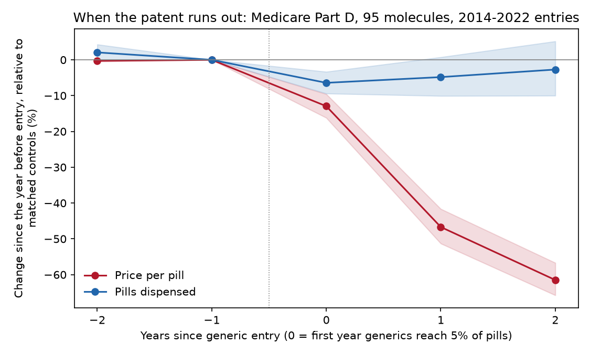
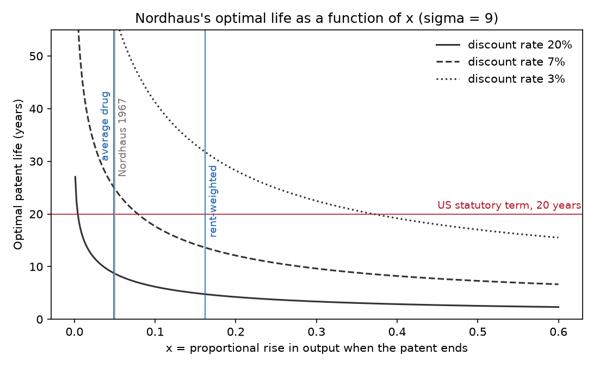
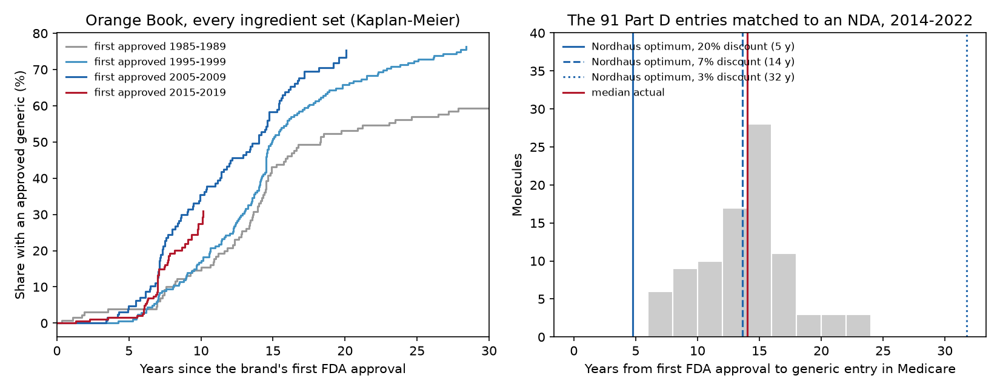

# How Long a Patent Should Last

### In 1969, William Nordhaus worked out how many years an inventor should keep a monopoly before everyone else gets the idea for free. With Medicare's records of 95 brand-name pills going generic, I worked it out again.

---

In 2018, Medicare's drug plans paid $2.95 billion for Lyrica, Pfizer's capsule for nerve pain and fibromyalgia. In
2019 generic pregabalin, the same molecule sold under its chemical name, reached pharmacy shelves. By 2021 the average
price Medicare paid per capsule of pregabalin, brand and generic together, was 89% lower than it had been in 2018, and
the number of capsules dispensed was 22% higher.

Those two numbers, how far the price falls when a patent ends and how much more of the product people then buy, are
the raw material of one of the oldest calculations in the economics of invention. A patent lets an inventor charge
more than the product costs to make, and that margin is what pays for the research. The cost of the arrangement is
the people who would have bought the product at the lower price and went without. A longer patent buys more
invention and more of that loss, and somewhere between zero and forever is a best length. A young Yale economist named
William Nordhaus was the first to write down a formula for it, and his formula turns out to need only one number
from the world, which Medicare now publishes every year.

---

## Two numbers and one formula

Call the price of the patented product $`p_0`$ and the quantity sold $`Q_0`$. When the patent ends, the price falls to
$`p_1`$ and the quantity rises to $`Q_1`$. Nordhaus worked with the proportional size of each change.

```math
B = \frac{p_0 - p_1}{p_0}, \qquad x = \frac{Q_1 - Q_0}{Q_0}, \qquad d = \frac{x}{B}
```

Here $`B`$ is the share of the price that disappears, $`x`$ is the proportional rise in use, and $`d`$, the ratio of the
two, is the elasticity of demand. For Lyrica, measured against similar drugs whose patent status did not change
over the same years (explained under "How I tested it"),

```math
B = 0.906, \qquad x = 0.154, \qquad d = \frac{0.154}{0.906} = 0.17
```

The matched numbers differ from the raw 89% and 22% above because other drugs' prices and use were moving too.

While the patent lasts, the owner collects the price gap on every unit sold, a monopoly rent $`R`$. The people priced
out lose a triangle of value, the deadweight loss $`L`$, because each of the $`xQ_0`$ units they would have bought was
worth more to them than it cost to make. With $`S = p_0 Q_0`$ for spending under the patent,

```math
R = B\,S, \qquad L = \tfrac{1}{2}\,(B p_0)(x Q_0) = \tfrac{1}{2}\,x\,R, \qquad \frac{L}{R} = \frac{x}{2}
```

For Lyrica, with $2.95 billion of spending in the last full patent year, that is

```math
R = 0.906 \times \$2.95\text{B} = \$2.67\text{B}, \qquad L = \tfrac{1}{2} \times 0.154 \times \$2.67\text{B} = \$0.21\text{B}
```

So each dollar of reward Pfizer collected on Lyrica cost patients and their insurers about 8 cents of value that
nobody received. Nordhaus's formula, derived in the next section, turns that ratio into a patent life. With $`\rho`$ the
discount rate and $`\sigma`$ a measure of how quickly research runs into diminishing returns,

```math
T^{*} = -\frac{1}{\rho}\,\ln\!\left(\frac{x\,\sigma/2}{x\,(1+\sigma/2)+1}\right)
```

Using Nordhaus's own values, $`\sigma = 9`$ and $`\rho = 0.20`$, Lyrica's number gives

```math
T^{*} = -\frac{1}{0.20}\,\ln\!\left(\frac{0.154 \times 4.5}{0.154 \times 5.5 + 1}\right) = -5\,\ln(0.375) \approx 4.9 \text{ years}
```

The formula runs from no limit at all, when nobody buys more once the price drops, to a very short life when use
jumps.

| What happens when the patent ends | x | Optimal life (σ = 9, ρ = 20%) |
|---|---|---|
| Nobody buys any more | 0 | No limit |
| Nordhaus's typical invention (d = 1, B = 0.05) | 0.05 | 8.7 years |
| Crestor, AstraZeneca's cholesterol pill, 2016 | 0.75 | 2.1 years |

---

## The paper and the man who wrote it

William Nordhaus took his bachelor's degree at Yale in 1963 and his doctorate at MIT in 1967, with a dissertation
titled "A Theory of Endogenous Technological Change." He joined the Yale faculty that year and stayed until he
retired in 2024. In November 1967 he circulated "The Optimal Life of a Patent" as Cowles Foundation Discussion Paper
241, written for the Econometric Society's December meetings, and the analysis went into his 1969 book *Invention,
Growth, and Welfare*, published by MIT Press. He began from a model Kenneth Arrow had sketched in 1962, a competitive
industry in which an outside inventor sells licenses for a cheaper production process and sets the royalty.

Nordhaus added the piece that made the problem solvable, an invention possibility function $`B(R)`$ that says how
large a cost saving $`R`$ dollars of research will buy, with diminishing returns. He assumed constant costs before
and after the invention and linear demand, normalized so that the old price and output both equal one. The inventor
collects the whole saving $`B`$ on each unit for $`T`$ years, after which the price falls by $`B`$ and output rises by
$`dB`$. Writing $`\varphi = 1 - e^{-\rho T}`$ for the share of the invention's discounted future that the patent covers
and $`s`$ for the cost of research,

```math
\begin{aligned}
\pi(R) &= \frac{\varphi\,B(R)}{\rho} - sR
  \;\;\Rightarrow\;\; \varphi\,B'(R) = s\rho \\
W(\varphi) &= \frac{B}{\rho} + \frac{d\,B^{2}\,(1-\varphi)}{2\rho} - sR(\varphi) \\
\frac{dW}{d\varphi} = 0 &\;\;\Rightarrow\;\; (1-\varphi)(1+dB) = \varphi\,\frac{\sigma\,dB}{2},
  \qquad \sigma \equiv -\frac{B''B}{B'^{2}} \\
\varphi^{*} &= \frac{dB+1}{dB\,(1+\sigma/2)+1},
  \qquad T^{*} = -\frac{1}{\rho}\ln(1-\varphi^{*})
\end{aligned}
```

The first line is the inventor choosing research to maximize profit, the second is society's gain (the saving forever
plus the triangle recovered after expiry, minus research), and the third sets the marginal value of a longer patent,
more research, against its marginal cost, a triangle of lost value that lasts longer. The demand elasticity and the size of the invention enter
only as the product $`dB = x`$, so the whole empirical content of the formula, given $`\sigma`$ and $`\rho`$, is how much
output rises when the patent ends.

Nordhaus chose $`\sigma = 9`$ from empirical work in his dissertation suggesting that 1% more research buys about 0.1% more cost reduction, a 20%
social rate of return, a demand elasticity of 1, and a 5% cost saving as the typical invention. His Table 1 put the
optimal life at 8.7 years, against the 17 years of United States law at the time, ranging from 27 years for trivial
inventions to under two years for the largest. He said plainly that the parameters were guesses, writing that "it is
more than modesty to note that the results are fanciful." In a footnote he went further for one industry. Citing
William Comanor's finding that a drug patent's effect on sales peaked in its second year, he suggested the optimal life
for pharmaceuticals should be much shorter than the statutory one.

Nordhaus went on to serve on President Carter's Council of Economic Advisers from 1977 to 1979 and as Yale's provost
from 1986 to 1988. He shared the 2018 Nobel Memorial Prize in Economic Sciences with Paul Romer, cited for integrating
climate change into long-run macroeconomic analysis.

The strongest objection to the patent paper is that length is only one dial. In 1990 Richard Gilbert and Carl Shapiro,
and separately Paul Klemperer, showed that once a patent's breadth (how much ground it covers against imitators) can
also be set, the best policy under some conditions is a patent that lasts forever but is very narrow, and under others
one that is broad but brief. Nordhaus raised breadth himself in 1967 and found that his model could not pin it down.
The data below measure what happens when a patent of a given breadth ends, so they can supply the input his formula
needs but cannot settle the question of breadth.

---

## How I tested it

The end of a patent is the one moment when both $`B`$ and $`x`$ can be seen. The Centers for Medicare and Medicaid
Services publish Medicare Part D spending, pills (dosage units) and prescriptions for every brand and generic
product, each release covering five calendar years. I used the nine releases from 2016 to 2024. A molecule "went
generic" in year $`E`$ if generic products were under 5% of its pills in the two years before, at least 5% in year
$`E`$, and at least half by the following year. That found 171 entries between 2014 and 2022. I kept the 95 whose
listings in the FDA's Orange Book are at least half oral tablets or capsules, so that a dosage unit is a pill, and that
had at least $10 million of Part D spending in the year before entry. The Orange Book is matched on the ingredient and
its salt where the names agree, so that a patch such as Flector (diclofenac epolamine) is not counted as a pill because
other salts of diclofenac come as tablets.

CMS revises its counts from one release to the next. For the same calendar year, the first and last releases agree
within 5% on a molecule's dosage units only 67% to 79% of the time, so I measured each entry entirely inside the one
release that covers the two years before it and the two after. Each drug is compared with the 10 molecules in that
release whose generic status did not change over those years and whose use grew most like it did in the year before
entry. For drug $`i`$ with entry year $`E_i`$, its matched controls $`j \in \mathcal{C}_i`$, and quantity $`Q`$,

```math
\begin{aligned}
\ln Q_{j,t} - \ln Q_{j,E_i-1} &= \lambda_{i,t} + \delta_{i,t-E_i}\,\mathbf{1}[\,j = i\,] + \varepsilon_{j,t},
  \qquad j \in \{i\} \cup \mathcal{C}_i \\
\hat{x}_i &= e^{\hat{\delta}_{i,2}} - 1,
  \qquad H_0:\; x = 0
\end{aligned}
```

The event-by-year effect $`\lambda_{i,t}`$ is the controls' average change, so $`\hat{\delta}_{i,2}`$ is the drug's change in
log pills from the year before entry to two years after, net of its controls, and $`\varepsilon_{j,t}`$ is everything else.
The price fall $`\hat{B}_i = 1 - e^{\hat{\delta}^{P}_{i,2}}`$ comes from the same equation with log price per pill in place
of log pills, using a second set of 10 controls matched on the year-before change in price. I summarize the 95 drugs three ways,
the plain average of $`\hat{x}_i`$, the median, and an average weighted by each drug's monopoly rent $`R_i = \hat{B}_i S_i`$,
which is the version that matches Nordhaus's ratio of total loss to total reward. Confidence intervals are percentiles
from resampling the 95 drugs 2,000 times, holding each drug's controls fixed. For the patent life I used Nordhaus's
$`\sigma = 9`$ and $`\rho = 20\%`$, and also
the 7% and 3% real rates that the Office of Management and Budget's Circular A-4 (2003) told federal agencies to use.

Two substitutions matter. Part D prices are gross of manufacturers' confidential rebates, so the brand prices, and with
them $`B`$ and the dollar figures, are overstated, though the pill counts, and so $`x`$ and $`T^{*}`$, are not affected.
And a new drug is a product invention, while Nordhaus's formula is for a cheaper process in a competitive industry. I
use it because by his own definition an invention is run-of-the-mill when output less than doubles at expiry, which
holds for 97% of these drugs.

---

## Nordhaus's table still comes out of his formula

Recomputing all 66 printed cells of his Table 1 from the formula reproduces every one to within 0.1 years, and his
sensitivity checks (5.6 years at $`\sigma = 20`$, 12.2 at $`\sigma = 4`$) come out at 5.66 and 12.21. A few cells from
the row for a demand elasticity of 1:

| Cost saving B | 0.001 | 0.01 | 0.05 | 0.20 | 0.90 |
|---|---|---|---|---|---|
| Nordhaus, 1967 (years) | 27.0 | 15.8 | 8.7 | 4.2 | 1.9 |
| Recomputed (years) | 27.05 | 15.77 | 8.67 | 4.24 | 1.92 |

One small inconsistency turned up. The text defines a drastic invention as one where output more than doubles,
$`dB > 1`$, but the six cells the table leaves out as drastic all have $`dB`$ between 0.125 and 0.675, and 11 printed
cells have $`dB`$ above 1. The table appears to have used the rule $`B > d`$ instead. It does not touch the 8.7-year
headline.

---

## When a patent ends, the price collapses and use barely moves



Relative to matched controls, the price per pill falls 13% in the year generics arrive, 47% the year after and 61%
the year after that. Per drug, the average fall two years out is 55%, and 70% when weighted by spending. The number of
pills moved far less over the same years.

```math
\bar{x} = 0.048\;[-0.036,\ 0.141], \qquad \tilde{x} = 0.020\;[-0.081,\ 0.087], \qquad N = 95
```

The typical drug, the median $`\tilde{x}`$, sold 2% more pills two years after its price fell by more than half, and the
average of 5% has a confidence interval that includes zero. Use rose for 52% of the drugs, and for 61% it either fell or rose by
less than 10%. Counting prescriptions instead of pills, the rise disappears altogether (a rent-weighted change of 0.7%),
which means that where pill counts grew, each prescription carried more of them. The simplest reading is that insured
Medicare patients were mostly already getting the drug they were prescribed, so for most of these medicines the
patent's deadweight loss was close to nothing.

---

## A few blockbusters carry most of the lost output

| Brand (maker) | Generic entry | Part D spending, year before | Price change | Pills change | Rent per year | Deadweight loss per year |
|---|---|---|---|---|---|---|
| Lyrica (Pfizer) | 2019 | $2.95B | −91% | +15% | $2.67B | $205M |
| Crestor (AstraZeneca) | 2016 | $2.88B | −88% | +75% | $2.55B | $952M |
| Nexium (AstraZeneca) | 2015 | $2.65B | −62% | −7% | $1.64B | −$54M |
| Abilify (Otsuka) | 2015 | $2.58B | −81% | +18% | $2.08B | $184M |
| Cymbalta (Eli Lilly) | 2014 | $1.99B | −88% | +22% | $1.75B | $193M |
| Namenda (Forest/Allergan) | 2015 | $1.89B | −55% | +21% | $1.03B | $106M |
| Zytiga (Janssen) | 2019 | $1.50B | −74% | +10% | $1.11B | $53M |
| Zetia (Merck) | 2017 | $1.46B | −90% | +58% | $1.32B | $384M |
| Gleevec (Novartis) | 2016 | $1.23B | −54% | −9% | $0.66B | −$29M |
| Diovan (Novartis) | 2014 | $1.22B | −83% | +8% | $1.01B | $41M |

*The ten drugs with the most Part D spending in the year before generic entry. Entry is the first year generics
reached 5% of the molecule's pills. Changes are two years after entry against matched controls. Rent and deadweight
loss use the formulas above.*

Across all 95 drugs, the monopoly rent in the last full patent year comes to $26.9 billion and the deadweight loss to
$2.2 billion, or 8 cents of loss per dollar of reward. Crestor and Zetia, two cholesterol pills, account for 48% of
the deadweight loss among the drugs whose use rose, and the top five for 69%. Weighting each drug by its rent gives

```math
\hat{x}^{R} = \frac{\sum_i \hat{x}_i R_i}{\sum_i R_i} = 0.162\;[0.042,\ 0.288], \qquad \frac{L}{R} = 0.081, \qquad N = 95
```

Crestor's 75% jump probably includes patients switched from other cholesterol drugs that were already cheap, which is a
shift between products rather than new use, so even this figure leans high. Nexium and Gleevec sold fewer pills after
their prices fell, a pattern that fits patients moving to newer medicines or buying outside the program, which a lower
price does not reverse.

---

## The discount rate decides the answer

Feeding these numbers into Nordhaus's formula with his own $`\sigma = 9`$ gives

```math
\begin{aligned}
T^{*}(\hat{x}^{R} = 0.162) &= 4.8 \text{ years at } \rho = 0.20, \quad 13.6 \text{ at } 0.07, \quad 31.8 \text{ at } 0.03 \\
T^{*}(\bar{x} = 0.048) &= 8.8 \text{ years at } \rho = 0.20, \quad 25.1 \text{ at } 0.07, \quad 58.6 \text{ at } 0.03
\end{aligned}
```

At Nordhaus's 20% rate the average drug lands almost exactly on his own 8.7 years, because its use rose by about the 5%
he assumed for a typical invention, though that average is not distinguishable from zero, and at zero the formula sets
no limit. Weighting by rent, the blockbusters pull the answer down to 4.8 years. At lower rates the same evidence
supports lives of 14 to 59 years. A discount rate is a statement about how much a dollar of benefit years from now is worth today, and research pays off far in the
future while the deadweight loss comes first. Nordhaus took 20% from 1960s estimates of the social return to capital.
The 7% and 3% rates of the 2003 federal guidance give the future research much more weight, and so
favor longer patents.



A drug's patent term is 20 years from the filing date, which usually comes years before approval, so the useful
measure of how long the monopoly lasts is the time from FDA approval to generic competition. For the 91 drugs here
whose first approval is in the Orange Book, the median is 14 years from first approval to the year generics arrived in
Medicare, with half between 11 and 15. Across all 1,096 active ingredients first approved from 1985 to 2019, half
had an approved generic within 14.5 years. That window has shortened, from a median of 18.3 years for drugs first approved in the late
1980s to 13.0 for those approved in 2010 to 2014.



For the rent-weighted estimate, the drugs' actual exclusivity sits almost exactly on Nordhaus's optimum at a 7%
discount rate, about three times his optimum at 20%, and well under it at 3%, and nothing in the Part D data
chooses among those rates.

---

## Why it matters

For patients, the price collapse at the end of a patent is large and fast, and for most drugs it brings almost no new
users, because insured patients mostly get the medicine their doctor prescribes either way. The loss from patents falls
mainly on those who pay, not on those left untreated, with the clear exceptions of mass-market pills like Crestor and
Zetia.

For drug makers, the rent figures show what is at stake when a patent ends. Pfizer's Lyrica alone gave up about $2.7 billion
a year of Part D rent, and the 95 drugs together about $27 billion. Under Nordhaus's logic that rent is the reward
that paid for the research, and the data say it came at a cost of 8 cents on the dollar.

For Medicare and taxpayers, the rent is mostly a transfer from the program to the patent holder while the patent
lasts, not a loss to the economy. Whether it is too large a transfer is the question of how much research it buys,
which these data cannot answer.

For policy, the result moves the argument away from the elasticity of demand, which turns out to be small for most
drugs and easy to measure, and toward the discount rate and the responsiveness of research to reward, the two inputs
Nordhaus could only assume. Arguments for shortening or lengthening drug exclusivity are, underneath, arguments
about those two numbers.

---

## Limits of this study

Medicare Part D covers older and disabled Americans with insurance, whose out-of-pocket costs change much less than the
gross price when a generic arrives, so their response probably understates what uninsured buyers would do, and the dollar
figures exclude rebates the government cannot disclose. Two years after entry may be too soon to see the full rise in
use. Drugs that lose patients to newer brands at the same moment their patents end make expiry look less valuable, and
drugs like Crestor that gain patients from cheaper rivals make it look more valuable. The parameter $`\sigma`$ is still
Nordhaus's 1967 guess, and changing it from 4 to 20 moves the rent-weighted answer at a 20% discount rate from 7.6
years to 2.7. The pill rule rests on Orange Book listings rather than on what Part D actually dispensed, so a few
molecules sold in several forms may still mix pills with other units. And the formula itself leaves out what Nordhaus listed as its own problems, including patent breadth,
races between rival inventors and the way one invention makes the next one cheaper.

---

## Further reading

- [TECHNICAL.md](TECHNICAL.md), the methods, full results, reproduction steps and references.
- [results/FINDINGS.md](results/FINDINGS.md), a plain-English summary and every table the scripts produce.
- [METHODS_REVIEW.md](METHODS_REVIEW.md), a methods and reporting review of the original paper.
- The original work is William D. Nordhaus, *Invention, Growth, and Welfare: A Theoretical Treatment of Technological
  Change* (MIT Press, Cambridge, Massachusetts, 1969). The patent-life model and its tables first appeared as William D.
  Nordhaus, "The Optimal Life of a Patent," Cowles Foundation Discussion Paper No. 241, Yale University, November 1967,
  which is free from the Cowles Foundation and is the version I read.
- Medicare Part D Spending by Drug, Centers for Medicare and Medicaid Services, historical Excel reports for 2016 to
  2024 (data.cms.gov), downloaded November 1, 2026.
- FDA Orange Book data files (products.txt, file dated October 9, 2026), downloaded November 1, 2026.

*Brendyn Beasley*
